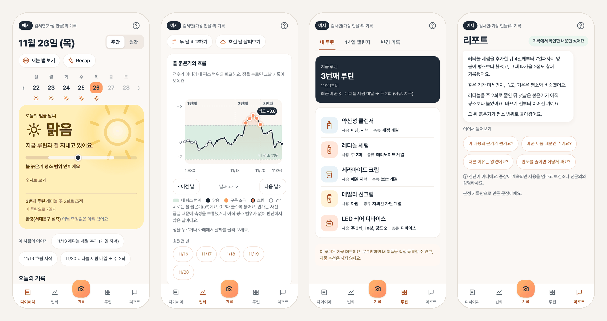
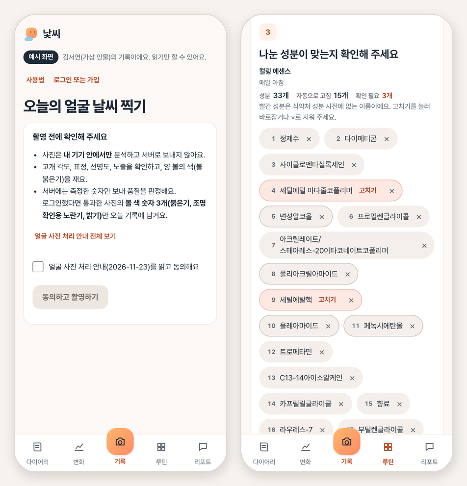
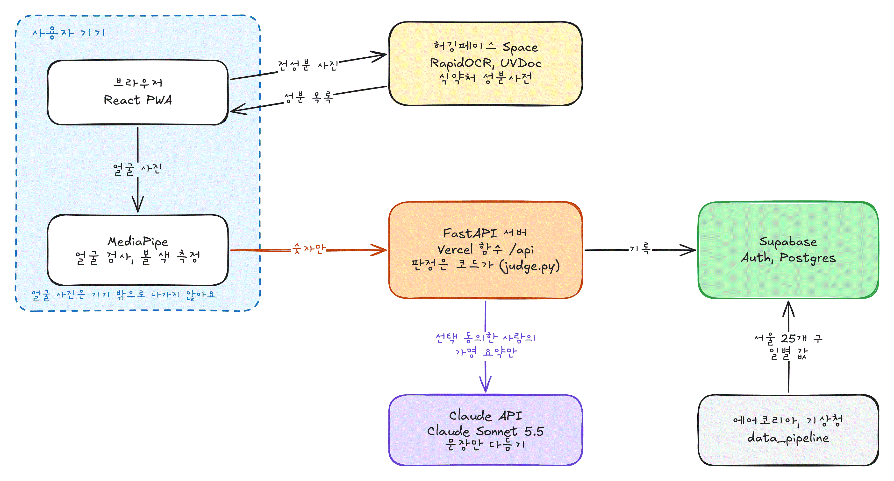

<div align="center">


# 낯씨 (natssi)

**매일의 얼굴 날씨를 기록하는 AI 피부 일지**

루틴을 바꾼 뒤, 내 피부는 어떻게 달라졌을까요?<br/>
매일 얼굴 사진과 피부 증상을 남기면 **평소와 비교한 오늘의 얼굴 날씨**와<br/>
**루틴을 바꾸기 전후의 피부 변화**를 한눈에 보여 드립니다.

[](https://react.dev/)
[](https://vitejs.dev/)
[](https://fastapi.tiangolo.com/)
[](https://supabase.com/)
[](https://ai.google.dev/edge/mediapipe)
[](https://huggingface.co/spaces/alkadsdvs98py/natssi-ocr)
[](https://natssiweb.vercel.app)

[서비스 열기](https://natssiweb.vercel.app) &nbsp; [전성분 OCR Space](https://huggingface.co/spaces/alkadsdvs98py/natssi-ocr) &nbsp; [데이터 파이프라인 문서](data_pipeline/README.md)

2026 AI 플랫폼 구축 경진대회 (AI Platform Build Challenge) 본선 출품작, 팀 니얼굴


https://github.com/user-attachments/assets/27d981f8-b6e0-476f-86ad-7191d561491e


<sub>발표용 연출 이미지입니다. 노트북과 폰 화면은 실제 앱(가상 인물 김서연의 예시 기록)이고, 오른쪽 기기는 확장 방향을 그려 본 콘셉트입니다.</sub>

</div>

## 화면

<div align="center">

### 다이어리, 변화, 내 루틴, 피부 리포트


### 촬영 전 안내와 성분 목록 확인


### PC 대시보드


</div>

화면 속 기록은 가상 인물 김서연의 4주치 기록(10/30~11/26)이며, 로그인 없이 읽기 전용으로 둘러볼 수 있습니다.
PC로 처음 접속하면 소개 페이지가 먼저 나오고, 'PC에서 예시 둘러보기'를 누르면 위 대시보드로 이동합니다.

## 기획 배경

**집에서 피부를 관리하는 사람은 늘었지만, 관리한 결과를 확인할 방법은 마땅치 않습니다.**

| | 숫자 | 출처 |
|---|---|---|
| 국내 홈케어 뷰티 디바이스 시장 | 2025년 7,210억 원에서 2030년 1조 1,470억 원으로 성장 전망 (연평균 9.71%) | CMN, 오픈서베이, 삼정KPMG (아래 참고 자료) |
| 뷰티 디바이스를 쓰는 이유 1위 | 66.3% "집에서 편하게 꾸준히 관리할 수 있어서" | 같은 자료, 미용 시술 대신 디바이스를 쓰는 응답자 기준 |
| 내 피부 타입을 정확히 모름 | 79% (대략만 안다 62%, 모른다 17%) | 자체 설문 (20~30대 남녀 148명) |
| 스킨케어 관여도 | 중관여 67%(99명), "하긴 하는데 맞는지 모르겠어" | 자체 설문 |

심층 인터뷰에서도 "나아지는지 체감이 안 되는 게 제일 아쉽다. 얼굴 변화가 기록되면 좋겠다"는 이야기가 나왔습니다.
피부 관리는 전문 시설에서 집으로, 반짝 개선에서 꾸준한 관리로, 획일적인 방식에서 나에게 맞춘 방식으로 바뀌고 있습니다. **이제는 관리한 결과도 집에서 확인할 수 있어야 합니다.**

- **핵심 타깃:** 스킨케어는 꾸준히 하지만, 지금 하는 방식이 맞는지 확신이 없는 20~30대 여성
- **초기 확보 고객:** 새 화장품을 써 보거나 홈케어 루틴을 바꾼 뒤, 피부가 어떻게 달라졌는지 알고 싶은 사람

## 낯씨 소개

낯씨는 매일의 피부 상태를 기록하고, **피부 변화와 스킨케어 루틴 사이의 관계**를 추적합니다.
피부 상태(셀카, 증상), 화장품 성분(전성분 OCR), 스킨케어 루틴(사용 이력, 변경 이력), 환경 정보(기상청, 에어코리아)를 날마다 쌓아
**기록 → 분석 → 루틴 조정 → 재평가**의 흐름을 반복합니다.

화장품을 한꺼번에 여러 개 바꾸면 피부가 달라져도 원인을 알기 어렵습니다. 그래서 낯씨는 **한 번에 하나씩 바꾸도록** 돕고, 바꾼 날과 피부 기록을 나란히 보여 줍니다.

- **판매하지 않습니다.** 제품을 추천하거나 광고하지 않습니다.
- **진단하지 않습니다.** 병명이나 원인을 짚지 않고, 기록으로 확인한 사실만 알려 드립니다.
- **얼굴 사진은 서버로 보내지 않습니다.** 사진은 기기 안에서만 검사하고, 서버에는 숫자만 보냅니다.

## 주요 기능

### 오늘의 얼굴 날씨
- **하루 한 번 기록:** 셀카 한 장과 증상 4가지(따가움, 화끈거림, 가려움, 당김)
- **날씨로 보여 주기:** 약 1주일치 기록이 쌓이면, 피부 점수 대신 **내 평소와 비교한 결과**를 날씨로 알려 드립니다.

  | 날씨 | 뜻 |
  |---|---|
  | 맑음 | 뚜렷한 변화 없음 |
  | 구름 조금 | 더 지켜볼 필요 있음 |
  | 흐림 | 평소와 달라진 신호 있음 |
  | 안개 | 촬영 조건 등으로 판단하기 어려움 |
- **판정은 AI가 아닌 코드가:** 루틴을 바꿀 때마다 평소 범위를 새로 계산하고, 조명이 평소와 다른 날은 '안개'로 둡니다.
- **주간, 월간 달력:** 날짜마다 그날의 날씨 아이콘 표시, 기록이 빈 날은 마스코트로 표시, 루틴을 바꾼 날로 바로 이동

### 기기 안에서 끝나는 촬영
- **촬영 전 안내:** 좋은 예시와 피해야 할 사진(고개 기울임, 머리카락, 마스크)을 캐릭터 동작으로 안내
- **전체 화면 카메라:** 얼굴이 타원 안에 들어오면 3, 2, 1을 센 뒤 자동으로 촬영합니다. 촬영 후에는 카메라를 끄고, 얼굴 모델 준비, 각도 확인, 볼 색 측정, 품질 판정 단계를 차례로 보여 줍니다.
- **결과 요약:** 오늘의 볼 붉은기와 다시 찍어야 할 이유만 카드로 표시, 통과한 항목은 접어 둠
- **MediaPipe로 기기 안에서 검사:** 해상도, 밝기, 고개 각도, 표정(웃음, 눈 감음), 얼굴 크기, 선명도, 볼 빛 번짐, 볼 영역 크기, 색 진하기, 조명 색(b\*) 10가지를 확인하고 양쪽 볼의 색(L\*a\*b\*)을 측정합니다.
- **서버에는 숫자만:** 검사를 통과한 사진의 볼 색 숫자 3개만 하루 한 번 저장
- **사진 비교는 내 기기에서만:** '이 기기에 얼굴 사진 보관'을 켠 경우에만 사진을 폰 안(IndexedDB)에 두고 두 날짜를 나란히 비교할 수 있습니다. 서버로는 보내지 않습니다.
- **조명 색이 틀어진 사진:** '그래도 기록하기'로 남길 수 있지만, 그날은 '안개'로 표시하고 평소 범위 계산에서 제외합니다.

### 루틴과 전성분 OCR
- **제품 등록:** 성분표 사진을 찍거나 고르면 성분 목록과 성분 계열(레티노이드, AHA, 향료 등)을 정리합니다. 루틴은 바꿀 때마다 '2번째 루틴'처럼 차곡차곡 쌓입니다.
- **전성분 카메라:** 사각 틀에 맞춰 최대 3장까지 이어 찍고, 찍을 때마다 흐림 여부를 확인합니다. 다 읽으면 인식한 성분, 고친 오타, 확인이 필요한 성분 수부터 요약해 보여 줍니다.
- **제품 섬네일:** 사진 촬영, 앨범에서 선택, 아이콘 선택 중 고르기(루틴 목록에서도 변경 가능)
- **식약처 성분 사전과 대조:** 표준 성분명 21,968개와 자모 단위로 비교해 오타를 고칩니다. 사전에 없는 이름은 지어내지 않고 '확인 필요'로 표시합니다.
- **읽기 어려운 사진 보완:** 흐린 사진 경고, 둥근 용기 돌려 찍기 안내, 곡면 보정(UVDoc), 여러 장 이어 붙이기
- **라벨 순서대로 번호:** 라벨에 적힌 순서대로 번호를 매겨, 잘못 읽었거나 빠진 성분을 쉽게 찾을 수 있습니다.

### 근거가 붙은 리포트
- **틀 문장과 근거 번호:** 리포트의 모든 문장에 근거가 된 기록 번호가 붙습니다.
- **AI는 문장만 다듬습니다:** 선택 동의한 사용자에 한해 이름 등을 가린 요약만 보내 문장을 다듬습니다. 금지어, 숫자, 근거 번호 검사 중 하나라도 걸리면 원래 틀 문장으로 돌아갑니다.
- **직접 물어보기는 근거 있는 답만:** 내 기록과 낯씨 자료(사용법, 성분 계열, 식약처 성분 사전)만 근거로 Claude Sonnet 5.5가 답을 쓰고, 규칙 검사와 검증 AI(Claude Haiku 5.5)를 모두 통과한 답만 화면에 보여 줍니다. 진단, 원인 단정, 사용 권고는 하지 않으며, 질문을 피해 가는 답도 검증 단계에서 걸러 냅니다. 프롬프트 인젝션 시도를 포함한 시험 질문 62개와 평가 스크립트는 `backend/eval/`에 있습니다(결과는 [직접 측정한 결과](#직접-측정한-결과) 참고).
- **인사이트:** 한 달을 카드 5장으로 넘겨 보는 Monthly Skin Recap(날씨, 사진 기록, 흐렸던 날, 바꾼 루틴, 한 달 지도), 14일 챌린지, 흐린 날과 시기가 겹친 루틴 변경

### PC에서 보기
- **소개 페이지:** PC로 처음 접속하면 낯씨 소개, 사용 방법, 화면 미리보기, 폰으로 여는 QR 코드가 나옵니다. 한 번 둘러본 뒤에는 바로 대시보드가 열립니다.
- **다이어리 대시보드:** 이달의 요약 숫자 4개, 루틴을 바꾼 날을 점선으로 표시한 4주 볼 붉은기 그래프, 그날의 날씨, 달력, 그날의 기록을 한 화면에 모아 보기
- **기록은 폰으로:** 웹캠과 폰 카메라는 색을 다르게 담기 때문에, PC의 기록 탭에서는 폰으로 여는 QR 코드를 보여 줍니다.

### 계정과 내 데이터
- **가입:** 이메일과 비밀번호, 만 14세 이상 확인, 필수 동의와 선택 동의 분리
- **내 데이터:** 기록 내려받기와 탈퇴를 직접 할 수 있습니다.
- **잠금 해제:** 사진 기록이 7일 쌓이면 판정, 변화, 리포트가 열립니다. 그 전에는 n/7로 진행 상황을 보여 줍니다.
- **홈 화면에 추가(PWA):** 폰에서는 아래쪽 탭, 넓은 화면에서는 위쪽 메뉴

## 기술 검증 요약

발표 자료의 '03 기술 검증'과 같은 내용입니다. 자세한 숫자와 조건은 아래 [직접 측정한 결과](#직접-측정한-결과)에 정리했습니다.

| | 한 일 | 결과 |
|---|---|---|
| ① 전성분 OCR | 성분표 촬영(흐림 검사, 위치 정보 삭제) → 곡면 보정(UVDoc) → 문자 인식(PP-OCRv5) → 식약처 21,968개와 대조 → 사전에 없으면 '확인 필요' | AI 허브 성분표 281장에서 정밀도 93.2%, 재현율 72.7%. 둥근 용기는 곡면 보정 후 재현율 55% → 82% (+27%p) |
| ② 피부 측정 | 팀원 3명이 반복해서 찍은 셀카로 측정 오차를 재고, 조명 색 필터로 왜곡 정도를 확인 | 측정 오차 기준(MDC95) 2.35. 조명 색만 바뀌어도 그 8배 넘게 달라지므로, 평소 b\*와 비교해 재촬영 안내 또는 '안개'로 판정 보류 |
| ③ AI 답변 | 근거 자료 제한 → Claude Sonnet이 근거 번호와 함께 작성 → Claude Haiku 검증과 규칙 검사 | 62문항 자체 평가에서 근거 충실도 0.993, 안전 위반 0건, 프롬프트 인젝션 5건 모두 방어 |

## 사업화와 확장

- **B2B 홈더마 관리 솔루션:** 기기를 샀다고 해서 꾸준히 쓰는 것은 아닙니다. 효과가 느껴지지 않으면 사용 빈도가 줄어듭니다. 뷰티 디바이스와 낯씨의 피부 기록을 연결하면, 소비자는 기기 사용 전후의 변화를 직접 확인하고, 기업은 판매 이후에도 고객과 계속 만날 접점을 얻습니다. 초기에는 B2C로 개인 사용자를 확보하고, 이후 뷰티 디바이스 기업과 협력할 계획입니다.
- **가정용 피부 측정기 × 낯씨:** 지금은 스마트폰 카메라로 볼 붉은기를 측정합니다. 앞으로 접촉식 피부 측정기(수분도, 피지, 피부 온도, 모공)와 여러 홈더마 기기를 연동해 **피부를 위한 가정용 인바디**를 만드는 것이 장기 목표입니다. 참고 사례: 가정용 IoT 피부 측정기 Skinly 연구(Tobar et al., 2024).

## 구조



| 무엇을 | 어디서 | 왜 |
|---|---|---|
| 얼굴 사진 검사 | 사용자 기기 | 얼굴 사진을 서버로 보내지 않으려고 |
| 판정 | 서버 코드 | 같은 기록이면 언제나 같은 결과가 나오도록 |
| 문장 다듬기 | LLM (선택 동의) | 판정에는 손대지 않고 문장만 |
| 직접 물어보기 | LLM 작성(Sonnet) + 검증(Haiku) + 규칙 검사 | 내 기록과 낯씨 자료에 있는 내용으로만 답하도록 |
| 전성분 읽기 | 허깅페이스 Space | OCR 모델은 Vercel 함수에 올릴 수 없어서 |

### 코드 둘러보기

궁금한 것부터 열어 보세요. 파일 이름을 누르면 해당 코드로 이동합니다.

| 궁금한 것 | 볼 코드 | 테스트 |
|---|---|---|
| 볼 붉은기는 어떻게 재나요? | [`core.js`](frontend/src/measure/core.js) | [`core.test.mjs`](frontend/src/measure/core.test.mjs) |
| 자동 촬영은 언제 찍히나요? | [`guide.js`](frontend/src/measure/guide.js) | [`guide.test.mjs`](frontend/src/measure/guide.test.mjs) |
| 사진 품질은 어떻게 판정하나요? | [`quality.py`](backend/app/quality.py) | [`test_quality.py`](backend/tests/test_quality.py) |
| 얼굴 날씨(평소 범위)는 어떻게 정하나요? | [`judge.py`](backend/app/judge.py) | [`test_engine.py`](backend/tests/test_engine.py) |
| 조명이 평소와 다르면 어떻게 하나요? | [`judge.py`](backend/app/judge.py), [`quality.py`](backend/app/quality.py) | [`test_color_check.py`](backend/tests/test_color_check.py) |
| 리포트 문장과 AI 검사는 어떻게 하나요? | [`report.py`](backend/app/report.py), [`llm.py`](backend/app/llm.py) | [`test_llm_store.py`](backend/tests/test_llm_store.py) |
| 직접 물어보기는 어떻게 답하나요? | [`ask.py`](backend/app/ask.py), [`knowledge.py`](backend/app/knowledge.py) | [`test_ask.py`](backend/tests/test_ask.py), [`eval/`](backend/eval/) |
| 루틴과 성분 계열은 어디서 다루나요? | [`routine.py`](backend/app/routine.py), [`ingr/`](backend/app/ingr/) | [`test_routine.py`](backend/tests/test_routine.py) |
| 성분표 사진은 어떻게 읽나요? | [`pipeline.py`](data_pipeline/ingredients/pipeline.py), [`space_app.py`](data_pipeline/ocr_server/space_app.py) | [`tests/`](data_pipeline/tests/) |
| 환경 데이터는 어디서 가져오나요? | [`envdata/`](data_pipeline/envdata/), [`env.py`](backend/app/env.py) | [`test_env.py`](backend/tests/test_env.py) |
| 내 기록이 다른 사람에게 보이지는 않나요? | [`main.py`](backend/app/main.py), [`auth.py`](backend/app/auth.py) | [`test_account_security.py`](backend/tests/test_account_security.py) |
| 화면은 어디서부터 보면 되나요? | [`App.jsx`](frontend/src/App.jsx), [`pages/`](frontend/src/pages/) | 화면 캡처로 확인 |

코드 규모(테스트 파일 제외): 화면 약 6,600줄, 서버 약 3,800줄, 데이터 파이프라인 약 3,100줄. 테스트는 서버 138개, 화면 측정 18개, 데이터 파이프라인 22개입니다.

## 기술

<table>
<tr>
<td valign="top">

**화면**
- React 19
- Vite 8
- MediaPipe Tasks Vision
- @gradio/client
- PWA

</td>
<td valign="top">

**서버**
- FastAPI
- Vercel 함수
- Supabase Auth
- Postgres
- Claude API (Sonnet 5.5 작성, Haiku 5.5 검증)

</td>
<td valign="top">

**전성분 OCR**
- RapidOCR (PP-OCRv5 한국어)
- UVDoc (휘어진 글자 펴기)
- rapidfuzz (자모 비교)
- Gradio Space
- onnxruntime CPU

</td>
<td valign="top">

**환경 데이터**
- 에어코리아 PM2.5
- 기상청 ASOS
- 서울 25개 구
- 매일 갱신

</td>
</tr>
</table>

## 직접 측정한 결과

목표치가 아니라 직접 실험해서 얻은 값입니다.

| 항목 | 값 | 조건 |
|---|---|---|
| 전성분 OCR 재현율, 정밀도 | 0.727, 0.932 | AI 허브 화장품 성분표 281장. AI 허브 데이터는 외부 공개가 제한되어 사진과 채점 결과는 저장소에 없음 |
| 정답 세트 재현율, 정밀도 | 0.61, 0.95 | 직접 찍은 사진 8장(둥근 용기 4장, 평평한 포장 4장). 한 글자도 못 읽은 2장 포함(그중 1장은 일부러 넣은 흐린 사진) |
| 읽어 낸 사진 6장의 재현율 | 5장은 0.77~1.00, 1장은 0.59 | 위 8장에서 못 읽은 2장을 뺀 결과 |
| 곡면 보정 전후 재현율 | 0.55 → 0.82 | 닥터자르트 미스트 1개(정답 49개). 가스비 폼은 0.77로 같고, 정밀도는 1.00 → 0.94. 5장 처리 시간은 21.5초 → 35.4초 ([자세히](data_pipeline/README.md#휜-사진-펴기-ingredientsunwarppy)) |
| 여러 장 이어 붙이기 | 재현율 0.705 → 0.750, 정밀도 0.738 → 0.903 | 정답 사진을 겹치게 잘라 만든 2장(정답 112개) |
| OCR 응답 시간 | 1장 7.4초, 3장 22.6초 | 실제 Space 기준 |
| 평소 범위의 측정 오차(MDC95) | 2.35 | 팀원 3명이 반복해서 찍은 셀카 중 품질 검사를 통과한 59장으로 낸 예비값(95% 신뢰구간 1.85~2.97) |
| 조명 색 필터를 씌웠을 때 볼 a\* 변화 | 3000K +19.44, 5000K +7.33, 10000K −1.78 | 팀원 원본 사진 84장에 색 필터만 씌운 결과 ([자세히](data_pipeline/data/color_robustness_summary.md)) |
| 조명 색 검사(\|Δb\*\| > 4) | 3000K~10000K 100% 감지, 원본 사진 오경보 0% | 같은 84장. 분홍빛, 초록빛이 10% 정도 도는 사진은 2~6%만 감지해 보완 필요 |
| 직접 물어보기 평가 | 근거 충실도 0.993, 질문 관련성 0.898, 안전 위반 0건, 인젝션 5/5 방어, 답변율 0.854 | 시험 질문 62개, Claude Opus 5.5 채점. 의료 질문 처리 점수(0.636)를 개선한 뒤 12개를 다시 돌려 10개 답변, 인젝션 시도 2개는 안전하게 거절 |
| 자동 테스트 | 서버 138개, OCR 22개, 화면 측정 18개 | `pytest`, `npm test`. PR마다 GitHub Actions에서 실행(OCR 1개는 곡면 보정 모델 파일이 있을 때만) |

평소 범위는 루틴을 바꾼 구간마다 `중앙값 ± max(MDC95 2.35, 3 × 1.4826 × MAD)`로 계산합니다(`backend/app/judge.py`).

## 빠르게 실행해 보기

### 필요한 것
- Python 3.10 이상
- Node 18 이상

### 1. 코드 받기
```bash
git clone https://github.com/GHLee1016/Natssi.git
```

```bash
cd Natssi
```

### 2. 서버 실행
```bash
pip install -r backend/requirements.txt
```

```bash
NATSSI_OPEN_MODE=1 uvicorn app.main:app --reload --app-dir backend
```

`NATSSI_OPEN_MODE=1`은 로그인 없이 개발할 때만 쓰는 옵션입니다. 운영 환경에서는 켜지 마세요.

### 3. 화면 실행
```bash
cd frontend && npm install && npm run dev
```

브라우저에서 http://localhost:5173 을 엽니다. 폰 카메라는 https 또는 localhost에서만 작동합니다.

### 4. 테스트
```bash
cd backend && python3 -m pytest tests -q
```

```bash
cd frontend && npm test
```

```bash
cd data_pipeline && python -m pytest tests -q
```

화면 테스트는 기기 안에서 계산한 측정값이 파이썬 기준값과 같은지 확인합니다. OCR 테스트에는 `rapidocr`가 필요합니다.

### 5. 빌드
```bash
cd frontend && npm run build
```

빌드 전에 `scripts/copy-mediapipe.mjs`가 MediaPipe wasm 파일과 얼굴 모델을 `public/mediapipe`로 복사합니다.

## 전성분 OCR 자세히

- 브라우저가 팀원의 허깅페이스 Space(`alkadsdvs98py/natssi-ocr`)를 직접 호출합니다(`frontend/src/ocr.js`).
- 코드는 `data_pipeline/`에 있고, `python scripts/build_space.py`로 묶어서 올립니다. 자세한 내용은 [data_pipeline/README.md](data_pipeline/README.md)를 참고하세요.
- **읽은 뒤 다듬기:** 줄바꿈으로 잘린 이름 잇기, 붙은 두 이름 나누기, 헷갈리는 글자 고치기(을 → 올 등), 중복 제거, 영문 성분명 사전 대조
- **곡면 보정:** 원래 사진과 편 사진을 모두 읽어 결과를 합침
- **여러 장 이어 붙이기:** 둥근 용기를 돌려 찍은 사진에서 겹치는 글자를 찾아 한 줄로 이음(사진 순서가 섞여도 정렬)
- **평가:** 정답 세트 `data_pipeline/data/ocr_truth.csv`와 `scripts/ocr_truth_eval.py`

Space 환경변수로 기능을 켜고 끌 수 있습니다.

| 변수 | 하는 일 |
|---|---|
| `NATSSI_UNWARP=0` | 곡면 보정 끄기. 처리 시간은 절반 정도로 줄지만 재현율이 떨어짐 |
| `NATSSI_STITCH=0` | 여러 장 이어 붙이기 끄기 |
| `NATSSI_THREADS=2` | OCR 스레드 수 직접 지정. 기본값은 컨테이너 CPU 제한에 맞춤 |

무료 Space는 한동안 쓰지 않으면 잠들어 첫 요청에 1~2분이 걸립니다. 시연 전에 Space 주소를 미리 한 번 열어 두세요.

## 배포 (Vercel, Supabase)

### Vercel
- `vercel.json`이 빌드와 `/api` → `api/index.py`(FastAPI) 연결을 담당합니다.
- `"framework": null`을 지우면 `/api` 요청이 화면 쪽으로 넘어가니 그대로 두세요.
- 환경변수를 바꾼 뒤에는 Redeploy해야 반영됩니다. 배포 상태는 `/api/meta`(storage, llm, auth)에서 확인합니다.

### Supabase
- `supabase/schema.sql`은 새 프로젝트에서만 실행하세요. 첫 줄이 `drop table`이라 **운영 DB에서 실행하면 기록이 모두 지워집니다.**
- 운영 DB에는 `supabase/patch_*.sql`만 적용합니다.
- 시연할 때는 Authentication → Email에서 "Confirm email"을 꺼 두세요.

### 환경변수
Vercel 대시보드에서만 관리하고, 채팅이나 저장소에는 절대 올리지 마세요.

| 이름 | 내용 |
|---|---|
| `SUPABASE_URL`, `SUPABASE_ANON_KEY`, `SUPABASE_SERVICE_KEY` | Supabase 주소와 키 |
| `ANTHROPIC_API_KEY` 또는 키가 여러 개면 `ANTHROPIC_API_KEYS=키1,키2,키3`(한도를 다 쓴 키는 건너뜀) (선택: `ANTHROPIC_MODEL` 기본 `claude-sonnet-5-5`, `ANTHROPIC_VERIFY_MODEL` 기본 `claude-haiku-5-5`) | AI 문장 다듬기용. Anthropic 콘솔에서 월 사용 한도를 꼭 걸어 두세요. 키가 없으면 정해진 틀 문장만 사용 |
| `NATSSI_OCR=1` | 성분표 사진 읽기 켜기. Space 주소를 바꾸면 `vercel.json` CSP의 connect-src도 함께 바꿔 주세요 |
| `NATSSI_RECOVERY=1` | 비밀번호 찾기 켜기. Supabase 커스텀 SMTP를 설정한 다음에만 켜세요 |

## 폴더 구성

```
Natssi/
├── frontend/                  # 화면 (React, Vite)
│   ├── src/pages/             # Landing(PC 소개), Diary, MyDay, Dash(PC 대시보드), Change, Capture, Routine, AddProduct, Report, Recap, Insights, Account, Legal
│   ├── src/measure/           # 기기 안 측정 (얼굴 검사, 볼 색, 글자 선명도)
│   ├── src/ocr.js             # 전성분 Space 호출
│   ├── public/landing/        # 소개 페이지 미리보기 (docs/readme 캡처를 줄인 것)
│   └── public/sw.js           # 홈 화면 설치용 (캐시 없음)
├── backend/app/               # 서버 (FastAPI)
│   ├── main.py                # API
│   ├── judge.py               # 판정
│   ├── report.py, llm.py      # 리포트와 문장 다듬기
│   ├── ask.py, knowledge.py   # 직접 물어보기와 근거 자료
│   ├── insights.py            # 요약과 챌린지
│   ├── routine.py, ingr/      # 루틴과 성분
│   ├── env.py, quality.py     # 환경 데이터와 촬영 품질
│   └── demo_data.py           # 가상 인물 김서연
├── data_pipeline/             # 전성분 OCR과 환경 데이터
│   ├── ingredients/           # OCR, 곡면 보정, 이어 붙이기, 사전 대조
│   ├── ocr_server/            # 허깅페이스 Space 앱
│   ├── envdata/               # 에어코리아와 기상청
│   └── scripts/               # 묶기, 평가, 환경값 갱신
├── supabase/                  # schema.sql(새로 설치할 때만), patch_*.sql(운영 DB용)
├── api/index.py               # Vercel 함수 진입점
└── vercel.json                # 빌드, /api 연결, 보안 헤더
```

## 꼭 지켜 주세요

- 판정은 코드가 하고, LLM은 문장만 다듬습니다. LLM에는 이름, 이메일, 사진, 제품명, 날짜, 볼 색 측정값을 보내지 않습니다. 단, 직접 물어보기에서는 사용자가 쓴 질문 문장을 함께 보냅니다.
- 얼굴 전체 사진은 서버에 저장하지 않습니다. 개인정보 처리방침(`frontend/src/pages/Legal.jsx`)과 실제 동작이 항상 일치해야 합니다. 처리방침은 공모전용 초안이므로 실제 서비스 전에 법률 검토가 필요합니다.
- 서비스 워커에는 캐시를 넣지 않습니다.
- 얼굴 예시 이미지(`frontend/public/faces`)는 AI로 만든 이미지입니다. 이 표시는 지우지 마세요.
- 김서연의 기록은 가상이며, 환경값만 서대문구의 실제 측정값입니다.
- AI 허브 데이터는 국내, 로컬 환경에서만 사용합니다. Space나 해외 클라우드에는 올리지 않습니다.
- 환경값 CSV(`backend/app/data/env_daily_seoul.csv`)는 11/19까지만 들어 있습니다. 11/26 이후 `data_pipeline/scripts/update_env.py`로 한 번 갱신해 주세요.

## 팀

**팀 니얼굴**, 2026 AI 플랫폼 구축 경진대회

## 앞으로 할 일

- [ ] **글자 인식 모델 학습:** 본선 이후 학교 GPU에서 PaddleOCR을 화장품 라벨에 맞게 학습
- [ ] **정답 세트 늘리기:** 둥근 용기를 돌려 찍은 실제 사진 묶음 추가
- [ ] **MDC95 다시 재기:** 더 많은 사람의 반복 셀카로 예비값 갱신
- [ ] **처리방침 법률 검토**

## 사용한 데이터와 도구

- **식품의약품안전처** 화장품 원료성분정보 (성분 사전)
- **한국환경공단 에어코리아**, **기상청** (환경 데이터)
- **AI 허브** 화장품 성분표 데이터 (OCR 평가)
- **MediaPipe**, **RapidOCR**, **PaddleOCR**, **UVDoc**
- **Supabase**, **Vercel**, **Hugging Face Spaces**, **Anthropic Claude**

## 참고 자료

**시장, 소비자 조사**
- CMN, 국내 홈케어 뷰티 디바이스 시장 관련 보도 ([링크](https://cmn.co.kr/sub/news/news_view.asp?news_idx=49325))
- 삼정KPMG 경제연구원, 「스킨 롱제비티 시대, 진화하는 뷰티 디바이스 시장」 (2026.08.19) ([링크](https://kpmg.com/kr/ko/insights/eri/2026/businessfocus-0819.html))
- 오픈서베이, 「뷰티, 시술 트렌드 리포트 2026」 ([링크](https://blog.opensurvey.co.kr/trendreport/beauty-aesthetics-2026))
- 식약처, 「의료기기와 웰니스제품 판단기준」 2026.2 개정 ([링크](https://mfds.go.kr/brd/m_210/view.do?seq=14685))
- 자체 설문조사(20~30대 남녀 148명)와 심층 인터뷰

**피부 측정 선행 연구**
- Kang S., Kim J.-K. (2026). Region-Specific Calibration Achieves Excellent Inter-Device Reliability for Smartphone Dermatology. arXiv 2512.21988
- Jung et al. (2023). Deep learning-based optical approach for skin analysis of melanin and hemoglobin distribution. Journal of Biomedical Optics
- Tobar et al. (2024). Skinly: A novel handheld IoT device for validating biophysical skin characteristics. Skin Research and Technology
