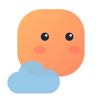
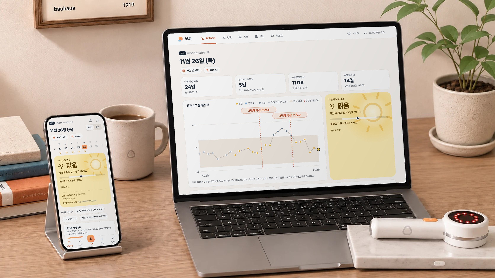
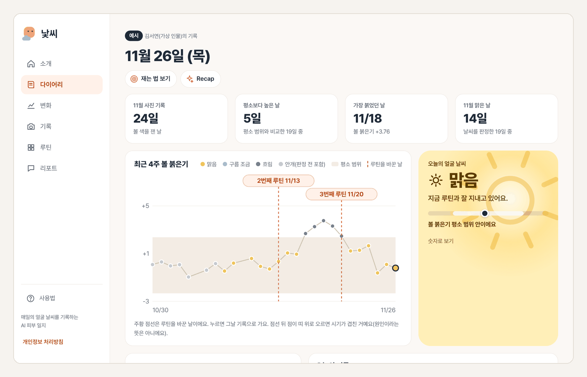

<div align="center">



# 낯씨 (natssi)

**매일의 얼굴 날씨를 기록하는 AI 루틴 일기**

루틴을 한 번에 하나씩 바꾸고 매일 셀카와 증상을 기록하면,<br/>
**평소와 달라진 날과 루틴을 바꾼 시기가 겹치는지** 보여 줘요.

[](https://react.dev/)
[](https://vitejs.dev/)
[](https://fastapi.tiangolo.com/)
[](https://supabase.com/)
[](https://ai.google.dev/edge/mediapipe)
[](https://huggingface.co/spaces/alkadsdvs98py/natssi-ocr)
[](https://natssiweb.vercel.app)

[서비스 열기](https://natssiweb.vercel.app) &nbsp; [전성분 OCR Space](https://huggingface.co/spaces/alkadsdvs98py/natssi-ocr) &nbsp; [데이터 파이프라인 문서](data_pipeline/README.md)

2026 AI 플랫폼 구축 경진대회 출품작


https://github.com/user-attachments/assets/27d981f8-b6e0-476f-86ad-7191d561491e




<sub>발표용 연출 이미지예요. 노트북과 폰 화면은 실제 앱(가상 인물 김서연의 예시 기록)이고, 오른쪽 기기는 확장 예시(콘셉트)예요.</sub>

</div>

## 화면

<div align="center">

### 다이어리, 변화, 내 루틴, 피부 리포트


### 촬영 전 안내와 성분 목록 확인


### PC 대시보드


</div>

화면 속 기록은 가상 인물 김서연의 4주 기록(10/30~11/26)이에요. 로그인하지 않아도 읽기 전용으로 볼 수 있어요.
PC에서 처음 열면 소개 페이지가 먼저 나오고, 'PC에서 예시 둘러보기'를 누르면 위 대시보드로 가요.

## 낯씨가 하는 일

홈더마 사용자는 제품을 여러 개 한꺼번에 바꾸는 일이 많아서, 피부가 달라져도 무엇 때문인지 알기 어려워요.
낯씨는 **한 번에 하나만 바꾸기**를 돕고, 바꾼 시기와 피부 기록을 나란히 보여 줘요.

- **판매하지 않아요.** 제품을 추천하거나 광고하지 않아요.
- **진단하지 않아요.** 병명이나 원인을 말하지 않고, 기록에서 확인한 내용만 보여 줘요.
- **얼굴 사진을 서버에 보내지 않아요.** 사진은 기기 안에서만 검사하고 숫자만 보내요.

## 주요 기능

### 오늘의 얼굴 날씨
- **하루 한 번 기록:** 셀카 한 장과 증상 4가지(따가움, 화끈, 가려움, 당김)를 남겨요.
- **날씨로 보여 주기:** 볼 붉은기가 내 평소 범위 안이면 '맑음', 넘으면 '흐림'처럼 보여요. 점수가 아니라 **내 평소와 비교**해요.
- **판정은 코드가 해요:** 루틴을 바꿀 때마다 평소 범위를 다시 계산하고, 조명이 맞지 않는 날은 '구분 불가'로 둬요.
- **주간, 월간 달력:** 날마다 그날의 날씨 아이콘이 붙고, 기록 없는 날은 마스코트가 비어 있다고 알려 줘요. 루틴을 바꾼 날로 바로 갈 수 있어요.

### 기기 안에서 끝나는 촬영
- **촬영 전 안내:** 좋은 사진 하나와 피할 사진(고개 기울임, 머리카락, 마스크)을 캐릭터 동작으로 보여 줘요.
- **전체 화면 카메라:** 얼굴이 타원에 맞으면 3, 2, 1을 세고 자동으로 찍어요. 찍은 뒤에는 카메라를 끄고, 분석 단계(얼굴 모델 준비, 각도 찾기, 볼 색 재기, 품질 판정)를 차례로 보여 줘요.
- **결과 요약:** 오늘 볼 붉은기와 고칠 항목만 카드로 보여 주고, 통과한 항목은 접어 둬요.
- **MediaPipe로 기기 안 검사:** 얼굴 위치, 고개 각도, 표정, 선명도, 노출을 확인하고 양 볼의 색(L\*a\*b\*)을 재요.
- **서버에는 숫자만:** 통과한 사진의 볼 색 숫자 3개만 하루 1번 저장해요.
- **볼 조각은 선택 동의:** 동의한 사람만 양 볼 조각(96px 2장)을 보관해 두 날을 비교해요. 동의를 끄거나 탈퇴하면 바로 지워요.

### 루틴과 전성분 OCR
- **제품 등록:** 전성분 사진을 찍거나 고르면 성분 목록과 성분 계열(레티노이드, AHA, 향료 등)을 읽어 와요. 루틴은 바꿀 때마다 '2번째 루틴'처럼 쌓여요.
- **전성분 카메라:** 사각 틀에 맞춰 최대 3장까지 이어 찍고, 찍을 때마다 흐림 검사를 해요. 읽는 동안 단계를 보여 주고, 읽은 성분, 고친 오타, 확인 필요 개수를 먼저 요약해요.
- **섬네일:** 제품 사진을 찍거나 고르거나, 아이콘 중에서 골라요. 루틴 목록에서도 바꿀 수 있어요.
- **식약처 성분사전 맞추기:** 21,968개 표준 이름과 자모 단위로 비교해 오타를 고쳐요. 사전에 없는 이름은 지어내지 않고 '확인 필요'로 보여 줘요.
- **읽기 어려운 사진 돕기:** 흐린 사진 경고, 둥근 통은 돌려 찍기 안내, 휜 사진 펴기(UVDoc), 여러 장 이어 붙이기.
- **라벨 순서와 번호:** 성분을 라벨에 적힌 순서대로 번호를 붙여 보여 줘서, 잘못 읽힌 성분과 빠진 성분을 쉽게 찾아요.

### 근거가 붙은 리포트
- **틀 문장과 근거 번호:** 모든 문장에 근거가 된 기록 번호가 붙어요.
- **AI는 문장만 다듬어요:** 선택 동의한 사람만 가명 요약을 보내 문장을 다듬어요. 금지어, 숫자, 근거 번호 검사에 걸리면 틀 문장으로 돌아가요.
- **직접 물어보기는 근거가 있는 답만 보여 줘요:** 내 기록과 낯씨 자료(사용법, 성분 계열, 식약처 성분 사전)만 근거로 Claude Sonnet 5.5가 답을 쓰고, 규칙 검사와 검증 AI(Claude Haiku 5.5)를 모두 통과한 답만 보여 줘요. 진단, 원인 단정, 사용 권고는 하지 않고, 질문을 피하는 답도 검증에서 걸러요. 시험 질문 57개로 충실도와 답변 관련성을 재는 평가 스크립트가 `backend/eval/`에 있어요.
- **인사이트:** 한 달을 카드 5장으로 넘겨 보는 Monthly Skin Recap(날씨, 사진 기록, 흐렸던 때, 바꾼 루틴, 한 달 지도), 14일 챌린지, 흐린 날과 시기가 겹친 루틴 변경.

### PC에서 보기
- **소개 페이지:** PC에서 처음 열면 낯씨 소개, 쓰는 법, 화면 미리보기, 폰으로 여는 QR이 나와요. 한 번 둘러보기를 누르면 다음부터는 바로 대시보드가 열려요.
- **다이어리 대시보드:** 이달 요약 숫자 4칸, 루틴을 바꾼 날을 점선으로 표시한 4주 볼 붉은기 그래프, 그날의 날씨, 달력, 그날의 기록을 한 화면에 보여 줘요.
- **기록은 폰으로:** 웹캠과 폰 카메라는 색을 다르게 잡아서, PC 기록 탭은 폰으로 여는 QR을 보여 줘요.

### 계정과 내 데이터
- **가입:** 이메일과 비밀번호, 만 14세 이상 확인, 필수 동의와 선택 동의 분리.
- **내 데이터:** 내려받기와 탈퇴를 직접 할 수 있어요.
- **잠금 해제:** 사진 기록이 7일 쌓이면 판정, 변화, 리포트가 열려요. 그 전에는 n/7로 보여요.
- **홈 화면에 추가(PWA):** 폰에서는 아래 탭, 넓은 화면에서는 위쪽 메뉴로 보여요.

## 구조


| 무엇 | 어디서 | 왜 |
|---|---|---|
| 얼굴 사진 검사 | 사용자 기기 | 얼굴 사진을 서버에 보내지 않으려고 |
| 판정 | 서버 코드 | 같은 기록에는 항상 같은 결과가 나오게 |
| 문장 다듬기 | LLM(선택 동의) | 판정에는 관여하지 않고 문장만 |
| 전성분 읽기 | 허깅페이스 Space | OCR 모델을 Vercel 함수에 올릴 수 없어서 |

### 코드 둘러보기

궁금한 것부터 바로 열어 보세요. 파일 이름을 누르면 열려요.

| 궁금한 것 | 보면 되는 코드 | 테스트 |
|---|---|---|
| 볼 붉은기는 어떻게 재나요? | [`core.js`](frontend/src/measure/core.js) | [`core.test.mjs`](frontend/src/measure/core.test.mjs) |
| 자동 촬영은 언제 찍나요? | [`guide.js`](frontend/src/measure/guide.js) | [`guide.test.mjs`](frontend/src/measure/guide.test.mjs) |
| 사진 품질은 어떻게 판정하나요? | [`quality.py`](backend/app/quality.py) | [`test_quality.py`](backend/tests/test_quality.py) |
| 얼굴 날씨(평소 범위)는 어떻게 정하나요? | [`judge.py`](backend/app/judge.py) | [`test_engine.py`](backend/tests/test_engine.py) |
| 조명이 다르면 어떻게 하나요? | [`judge.py`](backend/app/judge.py), [`quality.py`](backend/app/quality.py) | [`test_color_check.py`](backend/tests/test_color_check.py) |
| 리포트 문장과 AI 검사는요? | [`report.py`](backend/app/report.py), [`llm.py`](backend/app/llm.py) | [`test_llm_store.py`](backend/tests/test_llm_store.py) |
| 루틴과 성분 계열은요? | [`routine.py`](backend/app/routine.py), [`ingr/`](backend/app/ingr/) | [`test_routine.py`](backend/tests/test_routine.py) |
| 전성분 사진은 어떻게 읽나요? | [`pipeline.py`](data_pipeline/ingredients/pipeline.py), [`space_app.py`](data_pipeline/ocr_server/space_app.py) | [`tests/`](data_pipeline/tests/) |
| 환경 데이터는 어디서 오나요? | [`envdata/`](data_pipeline/envdata/), [`env.py`](backend/app/env.py) | [`test_env.py`](backend/tests/test_env.py) |
| 내 기록은 남에게 안 보이나요? | [`main.py`](backend/app/main.py), [`auth.py`](backend/app/auth.py) | [`test_account_security.py`](backend/tests/test_account_security.py) |
| 화면은 어디서 시작하나요? | [`App.jsx`](frontend/src/App.jsx), [`pages/`](frontend/src/pages/) | 화면 캡처로 확인 |

규모(테스트 파일 빼고): 화면 약 5,100줄, 서버 약 3,200줄, 데이터 파이프라인 약 2,900줄. 테스트: 서버 100개, 화면 측정 18개, 데이터 파이프라인 21개.

## 기술

<table>
<tr>
<td valign="top">

**화면**
- React 19
- Vite 8
- MediaPipe Tasks Vision
- @gradio/client
- PWA

</td>
<td valign="top">

**서버**
- FastAPI
- Vercel 함수
- Supabase Auth
- Postgres
- Claude API (Claude Sonnet 5.5)

</td>
<td valign="top">

**전성분 OCR**
- RapidOCR (PP-OCRv5 한국어)
- UVDoc (휜 사진 펴기)
- rapidfuzz (자모 비교)
- Gradio Space
- onnxruntime CPU

</td>
<td valign="top">

**환경 데이터**
- 에어코리아 PM2.5
- 기상청 ASOS
- 서울 25개 구
- 매일 갱신

</td>
</tr>
</table>

## 재 본 숫자

지어낸 목표값이 아니라 직접 잰 값이에요.

| 항목 | 값 | 조건 |
|---|---|---|
| 전성분 OCR 재현율, 정밀도 | 0.727, 0.932 | AI 허브 화장품 성분표 281장 |
| 정답 세트 재현율, 정밀도 | 0.61, 0.95 | 직접 찍은 사진 8장(둥근 통 4장, 평평한 사진 4장). 하나도 읽지 못한 2장 포함(그중 1장은 일부러 넣은 흐린 사진) |
| 읽힌 사진 6장의 재현율 | 5장은 0.77~1.00, 1장은 0.59 | 위 8장에서 읽지 못한 2장을 뺀 것 |
| OCR 응답 시간 | 1장 7.4초, 3장 22.6초 | 실제 Space |
| 평소 범위의 측정 오차(MDC95) | 2.35 | 팀원 3명의 반복 셀카로 낸 예비값(95% 신뢰구간 1.85~2.97) |
| 자동 테스트 | 서버 88개, OCR 22개, 화면 측정식 | `pytest`, `npm test`. GitHub Actions가 PR마다 돌려요(OCR 1개는 펴기 모델 파일이 있을 때만) |

평소 범위는 루틴을 바꾼 구간별로 `중앙값 ± max(MDC95 2.35, 3 × 1.4826 × MAD)`로 계산해요(`backend/app/judge.py`).

## 빠른 시작

### 준비물
- Python 3.10 이상
- Node 18 이상

### 1. 받기
```bash
git clone https://github.com/GHLee1016/Natssi.git
```

```bash
cd Natssi
```

### 2. 서버 켜기
```bash
pip install -r backend/requirements.txt
```

```bash
NATSSI_OPEN_MODE=1 uvicorn app.main:app --reload --app-dir backend
```

`NATSSI_OPEN_MODE=1`은 로그인 없이 개발할 때만 써요. 운영에서는 켜지 않아요.

### 3. 화면 켜기
```bash
cd frontend && npm install && npm run dev
```

http://localhost:5173 을 열어요. 폰 카메라는 https 또는 localhost에서만 켜져요.

### 4. 테스트
```bash
cd backend && python3 -m pytest tests -q
```

```bash
cd frontend && npm test
```

```bash
cd data_pipeline && python -m pytest tests -q
```

화면 테스트는 기기 안 측정 식이 파이썬 기준값과 맞는지 확인해요. OCR 테스트에는 `rapidocr`가 필요해요.

### 5. 빌드
```bash
cd frontend && npm run build
```

빌드 전에 `scripts/copy-mediapipe.mjs`가 MediaPipe wasm과 얼굴 모델을 `public/mediapipe`로 복사해요.

## 전성분 OCR 더 보기

- 브라우저가 팀원의 허깅페이스 Space(`alkadsdvs98py/natssi-ocr`)를 바로 불러요(`frontend/src/ocr.js`).
- 코드는 `data_pipeline/`에 있고 `python scripts/build_space.py`로 묶어 올려요. 자세한 건 [data_pipeline/README.md](data_pipeline/README.md)에 있어요.
- **읽은 뒤 다듬기:** 줄바꿈으로 잘린 이름 잇기, 붙은 두 이름 나누기, 헷갈리는 글자 고치기(을→올 등), 중복 제거, 영문 성분명 사전 맞추기.
- **휜 사진 펴기:** 원래 사진과 편 사진을 둘 다 읽어 합쳐요.
- **여러 장 이어 붙이기:** 둥근 통을 돌려 찍은 사진은 겹치는 글자를 찾아 한 줄로 이어요. 사진 순서가 뒤섞여도 맞춰요.
- **평가:** 정답 세트 `data_pipeline/data/ocr_truth.csv`와 `scripts/ocr_truth_eval.py`.

Space 변수로 켜고 끌 수 있어요.

| 변수 | 하는 일 |
|---|---|
| `NATSSI_UNWARP=0` | 휜 사진 펴기 끄기. 시간이 절반쯤 줄고 재현율이 낮아져요 |
| `NATSSI_STITCH=0` | 여러 장 이어 붙이기 끄기 |
| `NATSSI_THREADS=2` | OCR 스레드 수 직접 정하기. 기본은 컨테이너 CPU 제한에 맞춰요 |

무료 Space는 잠들면 첫 요청에 1~2분 걸려요. 시연 전에 Space 주소를 한 번 열어 두세요.

## 배포 (Vercel과 Supabase)

### Vercel
- `vercel.json`이 빌드와 `/api` → `api/index.py`(FastAPI) 연결을 맡아요.
- `"framework": null`을 지우면 `/api`가 화면으로 빠지니 그대로 두세요.
- 환경변수를 바꾼 뒤에는 Redeploy가 필요해요. 배포 상태는 `/api/meta`(storage, llm, auth)로 확인해요.

### Supabase
- 새 프로젝트에만 `supabase/schema.sql`을 실행하세요. 첫 줄이 `drop table`이라 **운영 DB에서 실행하면 기록이 지워져요.**
- 운영 DB에는 `supabase/patch_*.sql`만 써요.
- 시연용으로는 Authentication → Email의 "Confirm email"을 꺼요.

### 환경변수
Vercel 대시보드에서만 다루고, 채팅이나 저장소에 올리지 않아요.

| 이름 | 내용 |
|---|---|
| `SUPABASE_URL`, `SUPABASE_ANON_KEY`, `SUPABASE_SERVICE_KEY` | Supabase 주소와 키 |
| `ANTHROPIC_API_KEY` 또는 키가 여러 개면 `ANTHROPIC_API_KEYS=키1,키2,키3`(한도가 다 된 키는 건너뜀) (선택: `ANTHROPIC_MODEL` 기본 `claude-sonnet-5-5`, `ANTHROPIC_VERIFY_MODEL` 기본 `claude-haiku-5-5`) | AI 문장 다듬기. Anthropic 콘솔에서 월 사용 한도를 걸어 두세요. 키가 없으면 정해진 틀 문장만 써요 |
| `NATSSI_OCR=1` | 전성분 사진 읽기 켜기. Space 주소를 바꾸면 `vercel.json` CSP의 connect-src도 바꾸기 |
| `NATSSI_RECOVERY=1` | 비밀번호 찾기 켜기. Supabase 커스텀 SMTP를 설정한 뒤에만 |

## 폴더

```
Natssi/
├── frontend/                  # 화면 (React, Vite)
│   ├── src/pages/             # Landing(PC 소개), Diary, MyDay, Dash(PC 대시보드), Change, Capture, Routine, AddProduct, Report, Recap, Insights, Account, Legal
│   ├── src/measure/           # 기기 안 측정 (얼굴 검사, 볼 색, 글자 선명도)
│   ├── src/ocr.js             # 전성분 Space 호출
│   ├── public/landing/        # 소개 페이지 미리보기 (docs/readme 캡처를 줄인 것)
│   └── public/sw.js           # 홈 화면 설치용 (캐시 없음)
├── backend/app/               # 서버 (FastAPI)
│   ├── main.py                # API
│   ├── judge.py               # 판정
│   ├── report.py, llm.py      # 리포트와 문장 다듬기
│   ├── insights.py            # 요약과 챌린지
│   ├── routine.py, ingr/      # 루틴과 성분
│   ├── env.py, quality.py     # 환경 데이터와 촬영 품질
│   └── demo_data.py           # 가상 인물 김서연
├── data_pipeline/             # 전성분 OCR과 환경 데이터
│   ├── ingredients/           # OCR, 펴기, 이어 붙이기, 사전 맞추기
│   ├── ocr_server/            # 허깅페이스 Space 앱
│   ├── envdata/               # 에어코리아와 기상청
│   └── scripts/               # 묶기, 평가, 환경값 갱신
├── supabase/                  # schema.sql(새 설치 전용), patch_*.sql(운영 DB용)
├── api/index.py               # Vercel 함수 입구
└── vercel.json                # 빌드, /api 연결, 보안 헤더
```

## 지켜야 할 것

- 판정은 코드가 하고, LLM은 문장만 다듬어요. LLM에는 이름, 이메일, 사진, 제품 이름, 날짜, 볼 색 측정값을 보내지 않아요.
- 얼굴 전체 사진은 서버에 저장하지 않아요. 처리방침(`frontend/src/pages/Legal.jsx`)과 실제 동작이 일치해야 해요. 처리방침은 공모전용 초안이라 실서비스 전에 법률 검토가 필요해요.
- 서비스 워커에 캐시를 넣지 않아요.
- 얼굴 예시 이미지(`frontend/public/faces`)는 AI로 생성한 이미지예요. 표시를 유지하세요.
- 김서연 데이터는 가상이에요. 환경값만 서대문구 실제 측정값이에요.
- AI 허브 데이터는 국내와 로컬에서만 써요. Space나 해외 클라우드에 올리지 않아요.
- 환경값 CSV(`backend/app/data/env_daily_seoul.csv`)는 11/19까지 있어요. 11/26 이후 `data_pipeline/scripts/update_env.py`로 한 번 갱신하세요.

## 팀

**팀 니얼굴** · 2026 AI 플랫폼 구축 경진대회

## 다음 계획

- [ ] **글자 인식 모델 학습:** 본선 뒤 학교 GPU에서 PaddleOCR로 화장품 라벨에 맞게 학습
- [ ] **정답 세트 늘리기:** 둥근 통을 돌려 찍은 실제 사진 묶음 추가
- [ ] **MDC95 다시 재기:** 더 많은 사람의 반복 셀카로 예비값 바꾸기
- [ ] **처리방침 법률 검토**

## 쓴 데이터와 도구

- **식품의약품안전처** 화장품 원료성분정보 (성분사전)
- **한국환경공단 에어코리아**, **기상청** (환경 데이터)
- **AI 허브** 화장품 성분표 데이터 (OCR 평가)
- **MediaPipe**, **RapidOCR**, **PaddleOCR**, **UVDoc**
- **Supabase**, **Vercel**, **Hugging Face Spaces**, **Anthropic Claude**
